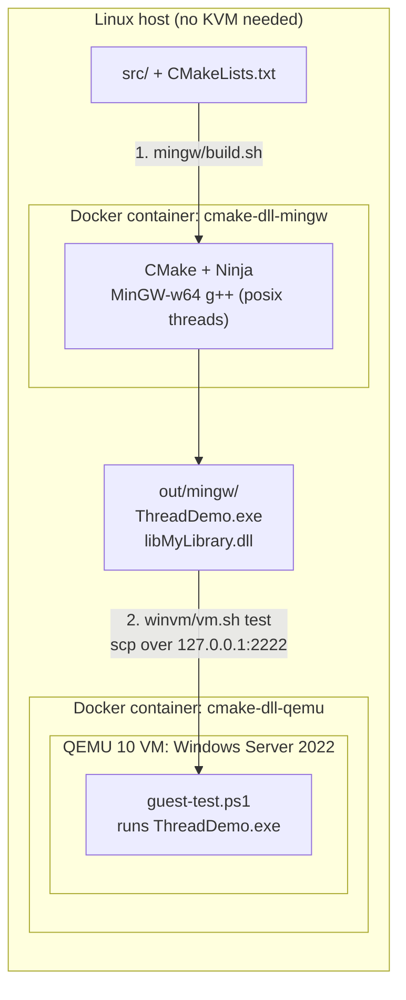
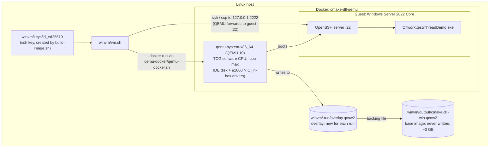
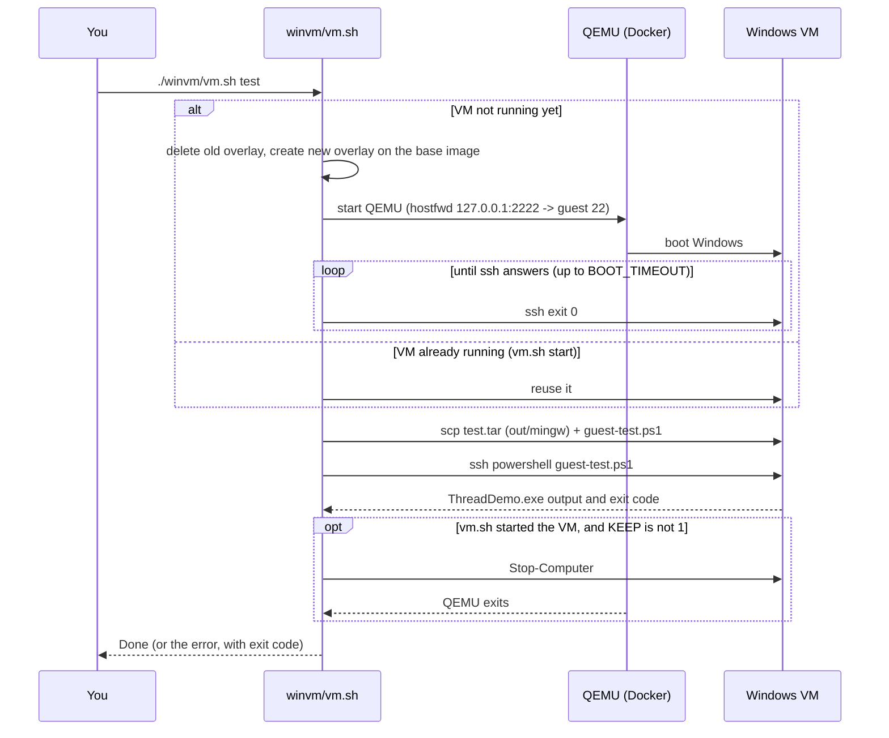
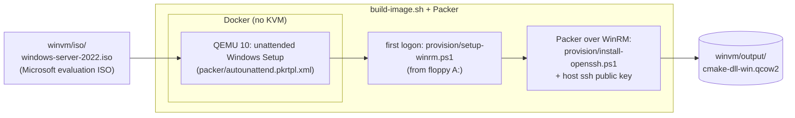
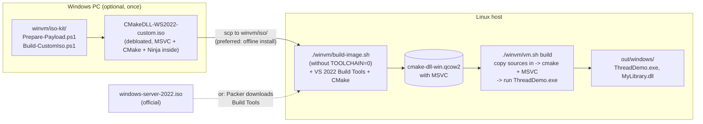

# Windows CMake Build on Linux

A small C++17 project (an executable plus a shared library) and the tooling to
build it **for Windows** and **test it on real Windows**, all from a Linux host.
No Windows PC and no KVM are needed for the main flow.

- `ThreadDemo.exe` starts a `std::thread` that calls an exported function from
  `libMyLibrary.dll`.
- **Build:** MinGW-w64 cross-compiles in a Docker container.
- **Test:** a Windows Server 2022 VM runs the EXE. QEMU runs in a second Docker
  container, so it works without KVM.

## Quick start

```sh
# One time (about 1 hour without KVM): see docs/winvm.md for the ISO download
TOOLCHAIN=0 ./winvm/build-image.sh      # ISO -> winvm/output/cmake-dll-win.qcow2

# Every change
./mingw/build.sh                        # build   -> out/mingw/  (about 1 min)
./winvm/vm.sh test                      # test on Windows        (about 5 min without KVM)
```

Expected end of `vm.sh test`:

```
==> Running ThreadDemo.exe inside the VM
Starting thread demo.
Hello from the shared library on a worker thread.
Thread finished.
==> Done.
```

## How it fits together

### Main flow: MinGW build in Docker, test in a QEMU Windows VM



### Inside the Docker + QEMU environment

`vm.sh` never starts Windows from the base image directly. Each run gets a new
copy-on-write overlay, so every test starts from the same clean Windows.



QEMU runs in Docker only on hosts without KVM, because the host's QEMU is too
old for Windows under software emulation (see [docs/winvm.md](docs/winvm.md)).
On a host **with** `/dev/kvm`, `vm.sh` uses the host's QEMU directly.

### What `vm.sh test` does



### One time: create the base image



## Optional flow: build with MSVC inside the VM

> **Not verified** on the current host. Use it only if you need MSVC output,
> for example a DLL that MSVC-built programs link against. MinGW and MSVC use
> different C++ ABIs, so `libMyLibrary.dll` from the main flow works only with
> programs that MinGW-w64 also builds.



```sh
./winvm/build-image.sh       # FORCE=1 to replace an existing MinGW-only image
./winvm/vm.sh build          # Release; or: vm.sh build Debug -> out/windows/
```

### Compare the two flows

| | Main: MinGW + VM test (verified) | Optional: MSVC in VM (not verified) |
|---|---|---|
| Compiler | MinGW-w64 g++ in Docker on Linux | MSVC (VS 2022 Build Tools) in Windows |
| ISO | official evaluation ISO | custom ISO from `winvm/iso-kit/`, or official ISO |
| Image build | `TOOLCHAIN=0 ./winvm/build-image.sh` | `./winvm/build-image.sh` |
| Image contains | Windows + OpenSSH | + VS 2022 Build Tools, CMake |
| Every change | `./mingw/build.sh` then `./winvm/vm.sh test` | `./winvm/vm.sh build` |
| Output | `out/mingw/` (`libMyLibrary.dll`, import lib `.dll.a`) | `out/windows/` (`MyLibrary.dll`, import lib `.lib`) |

## Repository layout

```
.
├── CMakeLists.txt, src/            the C++ project (library + demo executable)
├── cmake/toolchains/               MinGW-w64 toolchain file for cross-compiling
├── mingw/                          STEP 1: build for Windows in Docker
│   ├── Dockerfile                  Ubuntu + CMake + Ninja + MinGW-w64
│   └── build.sh                    -> build/mingw/, out/mingw/
├── winvm/                          STEP 2: Windows VM (test, or optional MSVC build)
│   ├── vm.sh                       every run: test | build | start | ssh | stop | reset
│   ├── build-image.sh              one time: ISO -> output/cmake-dll-win.qcow2
│   └── ...                         full file list: docs/winvm.md
├── docs/
│   ├── winvm.md                    VM host setup, files, options
│   └── iso-kit.md                  custom ISO step by step (Windows PC)
└── build/, out/                    generated, not in Git
```

## Build natively (no Windows needed)

Linux (`.so`):

```sh
cmake -S . -B build -DCMAKE_BUILD_TYPE=Release
cmake --build build --parallel
./build/bin/ThreadDemo
```

Windows with MSVC (Developer PowerShell):

```powershell
cmake -S . -B build
cmake --build build --config Release
.\build\bin\Release\ThreadDemo.exe
```

The executable and DLL go to the same output directory, so the Windows loader
finds the DLL when the executable starts.

## What to look at in the code

- `src/my_library.h` declares the exported API. `MYDLL_EXPORTS` is private to
  the library target, so it selects `dllexport` while the library builds and
  `dllimport` for consumers.
- `src/my_library.cpp` implements the library function.
- `src/main.cpp` runs the library function on a worker thread.
- `CMakeLists.txt` finds the platform thread library and puts runtime
  artifacts together in `bin/`.
- `cmake/toolchains/mingw-w64-x86_64.cmake` selects the `-posix` MinGW compiler
  (needed for `std::thread`) and links the GCC runtime statically, so the EXE
  and DLL need no extra DLLs on Windows.
